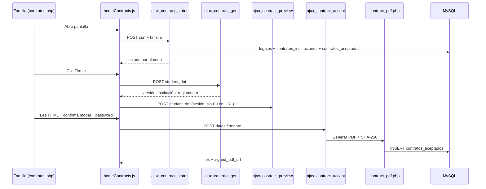

# NATTA App — Mapa frontend / backend

Referencia rápida: qué archivo PHP carga qué JS, qué AJAX consume y cómo encajan contratos, admin y secretaría.

**Guías ampliadas:** `guia-tecnica-devs.md` · `guia-funcional-admin.md`

---

## 1) Visión general

Hay dos superficies con el mismo frontend modular:

```text
App familias                          Panel admin / secretaría
────────────                          ────────────────────────
Vista PHP (HTML + page-data)          admin_dashboard.php / estado_alumno.php
        ↓                                      ↓
frontend/js/index.js                  data-page = admin-dashboard | estado-alumno
(data-page → pages/*Page.js)          adminDashboardPage.js / estadoAlumnoPage.js
        ↓                                      ↓
fetch → backend/ajax/*.php            admin/admin_ajax.php + POST handlers
        ↓                                      ↓
MySQL + storage/                      MySQL + docs/ + storage/
```

Contexto financiero de familias: `familiaContext.js` pide `ajax_familia_context.php` (no se embebe el saldo en `#page-data`).

---

## 2) Estructura de carpetas (resumida)

```text
natta-app/
├─ index.php, home.php, contratos.php, …
├─ contrato_documento.php
├─ contrato_documento_firmado.php
├─ politica-privacidad.php
├─ mantenimiento.php
├─ frontend/js/
│  ├─ index.js                    ← router data-page
│  ├─ config/apiEndpoints.js
│  ├─ core/                       ← layout, notificaciones, familiaContext
│  ├─ ui/                         ← pagos, QR, diálogos
│  └─ pages/
│     ├─ homePage.js
│     ├─ contratosPage.js
│     ├─ homeContracts.js         ← lógica compartida contratos
│     ├─ adminDashboardPage.js
│     ├─ adminQrApp.js
│     └─ estadoAlumnoPage.js      ← import directo desde estado_alumno.php
├─ backend/
│  ├─ bootstrap.php
│  ├─ ajax/                       ← 14 endpoints JSON de familias
│  ├─ lib/                        ← contratos, PDF, ingresantes, familia/talón
│  └─ tools/                      ← CLI only (.htaccess Deny + guard PHP_SAPI)
├─ admin/
│  ├─ admin_dashboard.php         ← pestañas (superadmin / admin)
│  ├─ estado_alumno.php           ← panel secretaría / directivo
│  ├─ admin_ajax.php
│  ├─ includes/                   ← auth, nav, cartas, cuotas, KPIs
│  └─ views/tabs/                 ← una vista por pestaña
├─ php/                           ← login, passwords, privacy gate, imports CSV
├─ includes/                      ← CV, PDF comunicados, QR modal
├─ docs/contratos/                ← plantillas HTML (no DB)
├─ docs/cartas-documento/         ← Excel de CD/NF + modelo DOCX
├─ storage/
│  ├─ contratos_firmados/         ← PDF firmados (no público)
│  └─ comunicados_pdfs/
├─ config/                        ← DB, sesión, SMTP, privacy, imports/
├─ importador-excel/              ← PhpSpreadsheet (rptfacing)
└─ css/, assets/, js/             ← estilos, logos escuelas, vendors
```

`estados_de_cuenta/` **ya no existe**. El sucesor es `admin/estado_alumno.php`.

---

## 3) Páginas dashboard familias → módulos JS

| Vista PHP | `data-page` | Módulo JS | Notas |
|-----------|-------------|-----------|-------|
| `home.php` | `home` | `homePage.js` | Estado cuenta + contratos |
| `contratos.php` | `contratos` | `contratosPage.js` | Firma y estado contrato |
| `info-importante.php` | `info-importante` | `infoImportantePage.js` | Comunicados |
| `instituciones.php` | `info-importante` | `infoImportantePage.js` | Contactos (mismo JS) |
| `agregaremail.php` | `agregar-email` | `agregarEmailPage.js` | Emails |
| `talondepago.php` | `talon-de-pago` | `talonDePagoPage.js` | Talones; pide también `ajax_talon_cuotas.php` |
| `librodesugerencias.php` | `libro-sugerencias` | `libroSugerenciasPage.js` | Sugerencias |
| `informarerror.php` | `informar-error` | `informarErrorPage.js` | Errores |

Todas usan `notificationsPanel.js`. La mayoría inicializa `paymentModal.js`.  
`familiaContext.js` carga contexto solo en esas páginas (no en admin).

### Páginas admin (mismo `index.js`)

| Vista PHP | `data-page` | Módulo JS |
|-----------|-------------|-----------|
| `admin/views/layout_start.php` | `admin-dashboard` | `adminDashboardPage.js` (+ `adminQrApp.js`) |
| `admin/estado_alumno.php` | `estado-alumno` | `estadoAlumnoPage.js` (import directo, no pasa por `PAGE_MODULES`) |
| `admin/control_usuarios.php` | `control-usuarios` | sin módulo de página |

### Vistas sin `data-page` de dashboard

| URL | Función |
|-----|---------|
| `index.php` | Login familias |
| `politica-privacidad.php` | Política pública |
| `php/privacy_gate.php` | Aceptación post-login |
| `mantenimiento.php` | Modo mantenimiento |
| `contrato_documento.php` | HTML personalizado (preview en sesión) |
| `contrato_documento_firmado.php` | Descarga PDF firmado |

---

## 4) Endpoints AJAX (familias)

Definidos en `frontend/js/config/apiEndpoints.js`.

### Cuenta y pagos

| Endpoint | Método | Uso |
|----------|--------|-----|
| `ajax_familia_context.php` | POST | Saldos y alumnos del grupo (lo pide `familiaContext.js`) |
| `ajax_cuotas.php` | POST | Cuotas para modal de pagos |
| `ajax_historial.php` | POST | Historial HTML por legajo |
| `ajax_talon_cuotas.php` | POST | Cuotas + solicitudes de talón por alumno |
| `ajax_solicitar_talon.php` | POST | Solicitar talones |
| `ajax_cancelar_solicitudes.php` | POST | Cancelar talones |
| `ajax_agregar_email.php` | POST | Solicitar email |
| `ajax_cancelar_solicitud_email.php` | POST | Cancelar solicitud email |

### Notificaciones

| Endpoint | Uso |
|----------|-----|
| `ajax_notificaciones.php` | Listado |
| `ajax_notificaciones_leer.php` | Marcar leídas |

### Contratos

| Endpoint | Uso | Respuesta clave |
|----------|-----|-----------------|
| `ajax_contract_status.php` | Estado por alumno del grupo | `status[]`: `signed`, `admin_aprobado`, `estado_flujo`, `es_ingresante_externo`, `firma_habilitada`, `pendiente_reubicacion`, `requisitos` |
| `ajax_contract_get.php` | Datos modal firma | `contract.contract_version`, `institucion_contrato` |
| `ajax_contract_preview.php` | Guarda DNI en sesión (sin PII en la URL) | luego se abre `contrato_documento.php` |
| `ajax_contract_accept.php` | Registrar firma | Genera PDF + inserta `contratos_aceptados` |

`estado_flujo` puede ser: `pendiente_firma`, `firma_bloqueada_noviembre`, `firma_bloqueada_adelanto_rv`, `firma_bloqueada_reubicacion`, `pendiente_aprobacion`, `aprobado`, `inactivo_sin_firma`.

### Vistas contrato (no AJAX)

| URL | Función |
|-----|---------|
| `contrato_documento.php` | HTML personalizado (lectura; datos vía sesión de preview) |
| `contrato_documento_firmado.php` | Descarga PDF firmado |

Constantes JS: `CONTRATO_DOCUMENTO_URL`, `CONTRATO_DOCUMENTO_FIRMADO_URL`, `REGLEMENTO_INSTITUCIONAL_2027_PDF_URL`.

---

## 5) Panel admin — mapa de archivos

```text
admin/admin_dashboard.php
    ├─ includes/auth.php + admin_user.php     roles y capabilities
    ├─ includes/nav.php                       grupos / pestañas
    ├─ includes/post_handlers.php             POST (comunicados, config, uploads)
    ├─ views/tabs/*.php                       UI de cada pestaña
    └─ frontend/js/pages/adminDashboardPage.js  toasts, heartbeat, QR

admin/estado_alumno.php
    ├─ includes/estado_alumno_lib.php
    ├─ views/estado_alumno_*.php
    └─ frontend/js/pages/estadoAlumnoPage.js    tablas ordenables

admin/admin_ajax.php
    └─ heartbeat por pestaña + estado/eliminar/modales
```

### Roles

| Rol | Entrada | Alcance |
|-----|---------|---------|
| `superadmin` | `admin_dashboard.php` | Todas las pestañas (`*`) |
| `admin` | `admin_dashboard.php` | Comunicados, QR, solicitudes, auditorías |
| `secretaria` | `estado_alumno.php` | Panel de su escuela |
| `directivo` | `estado_alumno.php` | Igual + Control de usuarios |

### Pestañas del dashboard (`?grupo=&tab=`)

**Sistema:** `actualizaciones`, `configuracion`, `usuarios`, `alta-alumnos-nuevos`, `cartas-doc`, `qr-app`, `auditoria`, `auditoria-app`  
(oculta: `lista-alumnos-nuevos`)

**Solicitudes:** `talones`, `informes`, `emails`, `sugerencias`

**Comunicados App:** `comunicados-generales`, `comunicados-individuales`

**Revisión Contratos:** `revision-contratos`

**Información General:** `informacion-matriculas`, `informacion-ingresado-facturado`, `informacion-app`, `listado-familias`, `estado-alumno`

Alias legacy: `comunicados` → `comunicados-generales`; `informacion-general` → `informacion-matriculas`.

### Vistas de `estado_alumno.php` (`?vista=`)

| `vista` | UI |
|---------|-----|
| `cuentas` | Estados de cuenta (default) |
| `listado_familias` | Agrupado por familia |
| `contratos` / `revision_contratos` | Firmas y documentación |
| `emails` | Contactos |
| `bolsa` | Currículums |
| `control_usuarios` | Solo dirección / admin |

Escuelas: CJ, HV, JA, SC, JN, MB, ET, SU (+ `ALL` en cuentas/listado).

### Exports admin

| Archivo | Qué baja |
|---------|----------|
| `exportar_csv.php` | Informes / emails / talones / sugerencias |
| `exportar_listado_familias.php` | CSV familias |
| `exportar_estado_alumno_emails.php` | Excel emails |
| `exportar_cartas_doc.php` | CSV CD/NF |
| `exportar_cartas_doc_xlsx.php` | Excel cotejo |
| `exportar_cartas_doc_cotejo.php` | Cotejo vs deuda |
| `exportar_cartas_doc_crear.php` | ZIP de cartas DOCX |
| `descargar_contrato_firmado.php` | PDF firmado |
| `descargar_curriculum_cv.php` | CV de bolsa |

---

## 6) Módulo contratos — mapa de archivos

```text
Familia (contratos.php / home)
    │
    ├─► homeContracts.js
    │       ├─► ajax_contract_status.php
    │       ├─► ajax_contract_get.php
    │       ├─► ajax_contract_preview.php  → sesión
    │       └─► ajax_contract_accept.php
    │
    ├─► contrato_documento.php
    │       └─► contract_preview_session.php + contract_render.php
    │               └─► docs/contratos/*.html
    │
    └─► contrato_documento_firmado.php
            └─► storage/contratos_firmados/

ajax_contract_accept.php
    └─► contract_pdf.php → Dompdf → storage + SHA-256
    └─► contract_institution.php → contratos_instituciones
```

### Base de datos (contratos)

| Tabla | Rol |
|-------|-----|
| **`contratos_instituciones`** | Config por colegio: directivo, ciclo (`contract_anio`, `contract_revision`), `contrato_activo`, `accepted_text` |
| **`contratos_aceptados`** | Firma por alumno + versión; SHA; ruta PDF; `admin_aprobado`; `info_erronea` |
| ~~`contracts`~~ | **Eliminada** (jun 2026) |

Plantillas: `docs/contratos/Contrato_{INST}_{AÑO}_{REV}.html`  
Código institución = últimas 2 letras del curso (`ET` → archivo `IDET`, `MB` → `IMB`).  
Ingresantes: cursos `EXCJ`…`EXET` → misma institución; ver `ingresantes_externos_2027.php`.

---

## 7) Ingresantes externos 2027 (mapa rápido)

```text
Curso EX*
    │
    ├─► ingresantes_externos_2027.php
    │       └─► solo cuota 10 liquidada (Adelanto RV 2027)
    │
    ├─► home / historial / talón / ajax_cuotas / familia_context
    │       └─► cuota_es_futura_para_curso(..., $curso)
    │
    └─► contract_institution.php
            ├─► firma si cuota 10 pagada
            └─► requisitos: adelanto aplica; resto_rv no aplica
                    └─► homeContracts.js (orden y textos distintos a regulares)
```

| Pieza | Rol |
|-------|-----|
| `ingresantes_externos_2027.php` | Lista de cursos, nombre cuota 10, `cuota_es_futura_para_curso` |
| `contract_institution.php` | `contrato_alumno_puede_firmar`, mensajes de bloqueo, requisitos, reubicación |
| `homeContracts.js` | UI estados + checklist post-firma por tipo de alumno |
| `admin/includes/cuotas_admin_lib.php` | Ventana de cuotas en listados admin (solo cuota 10 en EX*) |

---

## 8) Reubicación (bloqueo de firma)

Cursos que todavía no están en la institución del ciclo siguiente (o egresan) **no pueden firmar** aunque noviembre esté pago. Lista en `contrato_cursos_pendientes_reubicacion()`.

Al cambiar el código de curso, el bloqueo desaparece solo. UI: `estado_flujo = firma_bloqueada_reubicacion`.

---

## 9) Flujo: firma de contrato



---

## 10) Flujos clásicos (no contratos)

### Estado de cuenta

`home.php` → `ajax_familia_context.php` + `ajax_historial.php` + `ajax_cuotas.php` (modal pagos).  
Todos respetan `cuota_es_futura_para_curso` (ingresantes: solo cuota 10).

### Talones

`talondepago.php` → `ajax_talon_cuotas.php` + `ajax_solicitar_talon.php` / `ajax_cancelar_solicitudes.php`  
(+ filtro de cuotas liquidables por curso en `talon_context.php`).

### Auth familias

| UI | Proceso |
|----|---------|
| `index.php` → `php/login_padre.php` | Login |
| `php/privacy_gate.php` | Aceptar política vigente (si no hay aceptación) |
| `php/primer_ingreso.php` … | Alta clave |
| `php/olvide_password.php` … | Reset email |
| `php/logout.php` | Cerrar sesión |

Sesión: cookie `NATTAAPPSESSID`, path `/natta-app/`. Claves: `dni_alumno`, `nro_familia`, `csrf_token`.

---

## 11) Cartas documento

```text
admin pestaña cartas-doc
    └─► cartas_doc_lib.php
            ├─ Excel: docs/cartas-documento/legajo + resp/Legajos limpio prueba.xlsx
            ├─ Deuda: legajos activos (no inactivos)
            ├─ CD si adeuda mar–may; NF si adeuda jun–jul (y no CD)
            └─ ZIP DOCX desde docs/cartas-documento/modelo-CD/MODELO CARTA DOC.docx
```

Ingresantes EX* no entran al circuito CD/NF.

---

## 12) Configuración

| Archivo | Contenido |
|---------|-----------|
| `config/db.php` | Conexión MySQL |
| `config/session.php` | Cookie de sesión y headers |
| `config/app.php` | `APP_PUBLIC_URL`, modo mantenimiento |
| `config/app_audit.php` | `app_audit_log` |
| `config/smtp.php` | Mail (contratos, reset clave) |
| `config/privacy_policy.php` | Política vigente + hash |
| `config/cuota-vigente.php` | `getConfig` / `setConfig` |
| `backend/bootstrap.php` | Sesión, autoload, helpers familias |
| `admin/includes/bootstrap.php` | Sesión, CSRF, PDO admin |

---

## 13) Checklist: nueva página dashboard familias

1. Vista PHP + `data-page`.
2. `pages/nuevaPage.js` → `initNuevaPage`.
3. Registro en `index.js` (`PAGE_MODULES` + `PAGE_INIT_FNS`).
4. Si necesita saldo/alumnos: agregar el `data-page` a `PAGES_WITH_FAMILIA_CONTEXT`.
5. Endpoint + `apiEndpoints.js`.
6. Probar notificaciones y consola.

Nueva pestaña admin: `nav.php` + `admin_dashboard.php` `$tabViews` + `views/tabs/` + capability en `admin_user.php`.

---

## 14) SQL de referencia

| Archivo | Cuándo usar |
|---------|-------------|
| `docs/sql/u207063327_contactos_db.sql` | Esquema de contactos |
| `docs/sql/app_audit_log.sql` | Log de la app pública |
| `docs/sql/curriculums_area.sql` | Áreas de bolsa de trabajo |
| `docs/sql/curriculums_duplencias.sql` | Duplencias de CV |

---

*Última actualización: octubre 2026 — admin unificado, privacy gate, cartas documento, reubicación, contexto familiar por AJAX, `backend/tools/` solo CLI.*
